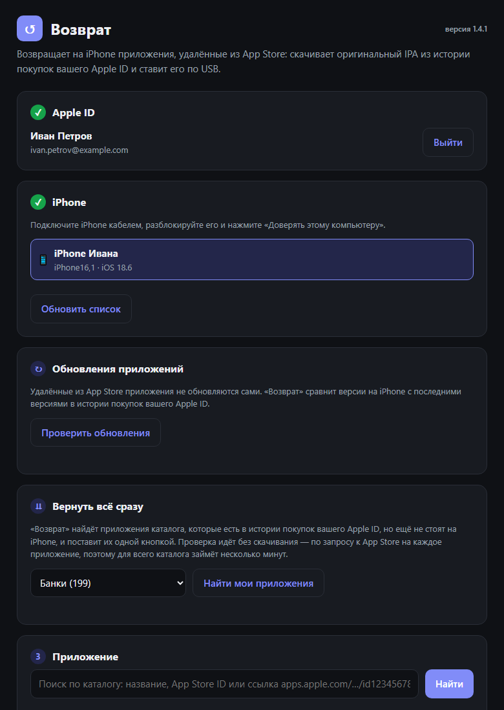
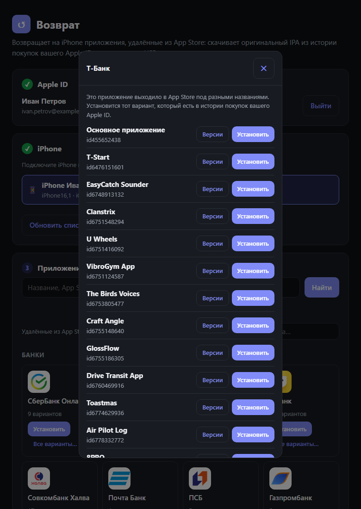
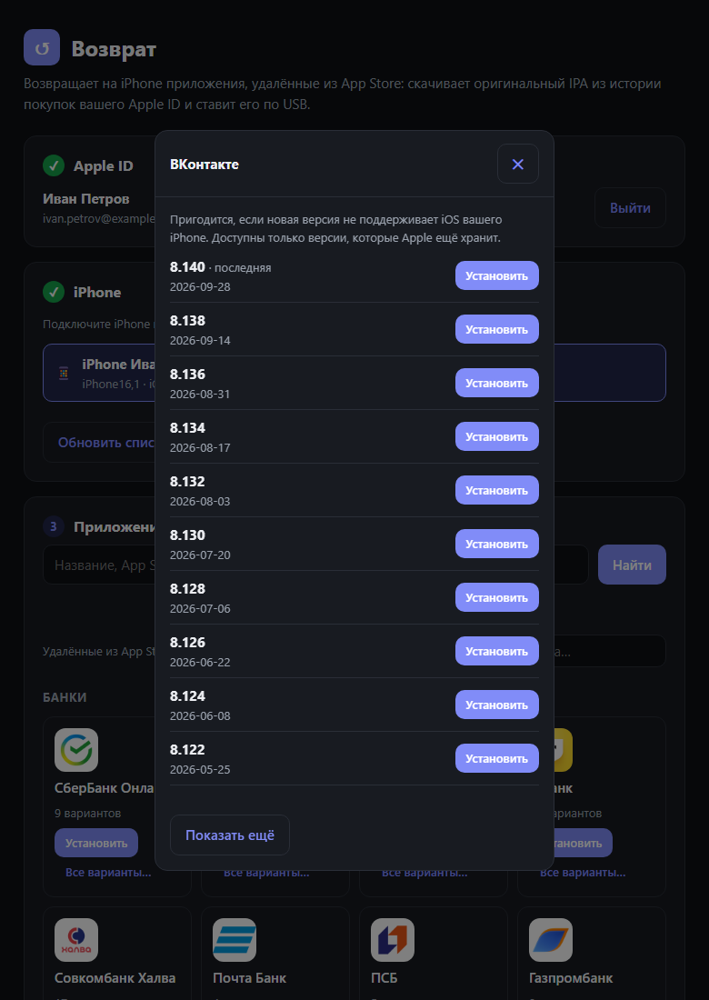
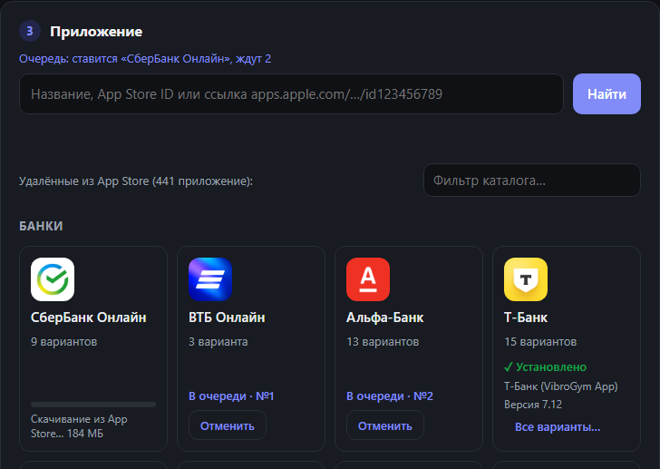

# back-to-iphone (Возврат)

Бесплатная программа для Windows, macOS и Linux, которая возвращает на iPhone приложения, удалённые из российского App Store:
банки (Сбер, ВТБ, Альфа, Т-Банк и другие), VK, MAX, Авито, Почту Mail.ru, игры Supercell.

Она скачивает **оригинальный IPA с подписью Apple** из истории покупок вашего Apple ID и ставит его на iPhone по USB.
Джейлбрейк и переподпись сертификатами не нужны, приложение не «протухает» через 7 дней.

**Сайт и инструкции:** [vozvrat.qd.je](https://vozvrat.qd.je/) · **Поддержка:** [@vzvrt_app](https://t.me/vzvrt_app)

> Работает только для приложений, которые **когда-то уже скачивались с вашего Apple ID**:
> Apple отдаёт их из истории покупок даже после удаления из магазина.

<p align="center"></p>

| Варианты одного бренда | Выбор версии |
|---|---|
|  |  |

<p align="center"></p>

<sub>Скриншоты сделаны на демо-данных: аккаунт и iPhone вымышленные.</sub>

## Возможности

- Вход в Apple ID с поддержкой двухфакторной аутентификации
- Каталог из 441 приложения, которых нет в российском App Store, с иконками, по категориям, с фильтром.
  В нём есть и приложения банков, выходившие под другими названиями, например «Т-Банк (VibroGym App)»
- Варианты одного бренда собраны в одну карточку (213 карточек на 441 приложение): «Установить» ставит
  основное приложение, а нужный вариант и его версию можно выбрать в окне «Все варианты…»
- Выбор версии приложения: пригодится, если последняя версия не поддерживает iOS вашего iPhone
- Проверка совместимости перед установкой: минимальная версия iOS и поддержка iPhone
- Поиск по каталогу с подсказками при вводе: понимает транслит («max» и «макс»), разговорные названия
  («сбол», «тинькофф») и небольшие опечатки
- Установка любого приложения по App Store ID или ссылке `apps.apple.com/.../id123456789`, даже если его нет в каталоге
- Очередь установок: можно нажать «Установить» у нескольких приложений сразу, они поставятся по очереди;
  ожидающие можно отменить
- Прогресс скачивания и установки прямо в карточке приложения, с процентами — если Apple сообщает размер
  (для приложений, которые ещё продаются в других странах). Идущее скачивание можно отменить
- Отметки «✓ На iPhone · версия» в каталоге: сразу видно, что уже стоит на телефоне
- «Вернуть всё сразу»: программа находит приложения каталога, которые есть в истории покупок вашего Apple ID,
  но ещё не стоят на iPhone, и ставит выбранные одной кнопкой
- Обновление установленных приложений: «Возврат» сравнивает версии на iPhone с последними версиями
  в истории покупок и предлагает обновить одним нажатием
- Каталог обновляется сам: при запуске программа берёт свежий список из репозитория
- Программа обновляется сама: при выходе новой версии достаточно нажать «Обновить»
- Опционально: сохранение скачанного IPA на компьютере

## Установка

Готовые сборки лежат на странице [Releases](https://github.com/n0hard/back-to-iphone/releases).
Python ставить не нужно: внутри уже есть Python, `ipatool` и `pymobiledevice3`.

| Система | Файл |
|---|---|
| Windows 10/11, 64 бит | `VozvratSetup.exe` |
| macOS 12+ на Apple Silicon (M1–M4) | `Vozvrat-macOS-arm64.dmg` |
| macOS 12+ на Intel | `Vozvrat-macOS-x64.dmg` |
| Linux x86_64 (Ubuntu 22.04+ и аналоги) | `Vozvrat-Linux-x64.AppImage` или `Vozvrat-Linux-x64.tar.gz` |

Для всех систем нужен кабель для iPhone.

### Windows

1. Установите драйвер Apple для работы с iPhone по USB: приложение
   [Apple Devices](https://apps.microsoft.com/detail/9np83lwlpz9k) из Microsoft Store или iTunes.
2. Запустите `VozvratSetup.exe`. Права администратора не нужны: программа ставится в
   `%LOCALAPPDATA%\Programs\Vozvrat` и создаёт ярлыки в меню «Пуск» и, по желанию, на рабочем столе.
   Если драйвера Apple нет, инсталлятор предупредит и в конце предложит открыть Microsoft Store.

Инсталлятор не подписан цифровой подписью, поэтому SmartScreen может показать «Неизвестный издатель».
Нажмите «Подробнее», затем «Выполнить в любом случае».

### macOS

1. Откройте `.dmg` и перетащите «Возврат» в «Программы». Драйвер ставить не нужно: он встроен в macOS.
2. Программа не подписана сертификатом Apple, поэтому при первом запуске macOS её заблокирует.
   Разрешите запуск одним из способов:
   - откройте «Системные настройки» → «Конфиденциальность и безопасность» и нажмите «Всё равно открыть»;
   - или выполните в Терминале:
     ```bash
     xattr -cr /Applications/Vozvrat.app
     ```
3. При первом подключении iPhone нажмите на телефоне «Доверять этому компьютеру».

### Linux

1. Установите службу `usbmuxd`, через неё система видит iPhone:
   ```bash
   sudo apt install usbmuxd
   ```
   В Fedora — `sudo dnf install usbmuxd`, в Arch — `sudo pacman -S usbmuxd`.
2. Сделайте AppImage исполняемым и запустите его:
   ```bash
   chmod +x Vozvrat-Linux-x64.AppImage
   ```
   ```bash
   ./Vozvrat-Linux-x64.AppImage
   ```
   Если AppImage не запускается из-за FUSE, используйте архив: распакуйте `Vozvrat-Linux-x64.tar.gz`
   и запустите `Vozvrat/Vozvrat`.

На Linux интерфейс открывается во вкладке браузера. Программа сама завершается через несколько минут
после закрытия вкладки, если ничего не устанавливается.

### Из исходников

Нужен [Python 3.11+](https://www.python.org/downloads/) (на Windows отметьте «Add to PATH») и драйвер
из инструкции для вашей системы. Склонируйте репозиторий:

```bash
git clone https://github.com/n0hard/back-to-iphone.git
```

Затем запустите `start.bat` (Windows), `start.command` (macOS) или `start.sh` (Linux). При первом запуске
скрипт установит зависимости из `requirements.txt` и скачает `ipatool` из
[официального релиза](https://github.com/majd/ipatool/releases) со сверкой SHA-256.
Интерфейс откроется в браузере на `http://127.0.0.1:8765`.

## Обновление программы

При запуске «Возврат» проверяет, вышла ли новая версия. Обновления бывают двух видов:

- **обычное** — сверху появляется плашка «Доступна новая версия», программой можно пользоваться дальше;
- **обязательное** — программа показывает окно «Вышла версия …» и не работает, пока её не обновят.

В обоих случаях достаточно нажать «Обновить»: программа скачает новую версию, проверит её контрольную сумму,
установит и откроется заново. Заходить на GitHub не нужно. Если проверить обновления не удалось (нет интернета
или GitHub недоступен), программа не запустится, пока проверка не пройдёт: нажмите «Повторить».

Запуск из исходников не блокируется — там обновление делается через `git pull`.

## Как пользоваться

1. **Apple ID.** Войдите в аккаунт, с которого приложение когда-то скачивалось. Первый вход может занять 1–3 минуты.
   Если включена двухфакторная аутентификация, появится поле для кода: введите код с вашего устройства Apple
   и снова нажмите «Войти».
2. **iPhone.** Подключите телефон кабелем, разблокируйте его и нажмите «Доверять этому компьютеру».
   Он появится в списке.
3. **Приложение.** Нажмите «Установить» в каталоге или найдите приложение по названию, ID или ссылке.
   Не отключайте кабель и не блокируйте экран, пока идёт установка.
   - Если в карточке несколько вариантов, например «Т-Банк · 15 вариантов», откройте «Все варианты…»
     и поставьте тот вариант, который вы когда-то скачивали. В истории покупок есть только он.
   - «Версии» или «Другая версия…» показывает все версии приложения, которые хранит Apple. Это нужно,
     если последняя версия требует более новую iOS, чем стоит на вашем iPhone.
   - Можно нажать «Установить» у нескольких приложений сразу: они встанут в очередь, а ожидающие можно отменить.

Флажок «купить, если нет в покупках» добавляет в историю бесплатные приложения, которые ещё есть в App Store.
Для уже удалённых приложений он не поможет.

## Частые проблемы

| Сообщение | Что делать |
|---|---|
| «Этого приложения нет в истории покупок» | Приложение не скачивалось с этого Apple ID. Попробуйте другой вариант в «Все варианты…» или другой аккаунт |
| «Нужна iOS … или новее» | Откройте «Версии» и поставьте более старую версию приложения |
| Не входит в Apple ID после использования IPA_Downloader и подобных программ | «Возврат» хранит сессию отдельно (на macOS и Linux — с 1.1.0, на Windows — с 1.4.1). Войдите в него ещё раз |
| «iPhone не найден» / «Не найден драйвер Apple» | Windows: установите Apple Devices или iTunes. Linux: установите и запустите `usbmuxd`. Затем переподключите кабель и разблокируйте iPhone |
| macOS: «Не удаётся открыть, так как разработчик не подтверждён» | См. раздел [macOS](#macos): «Всё равно открыть» или `xattr -cr` |
| «Нажмите „Доверять этому компьютеру“» | Разблокируйте iPhone и подтвердите доверие во всплывающем окне |
| Не приходят push-уведомления | Для части удалённых приложений Apple отключила пуши. Это ограничение Apple |
| Поиск пишет «В каталоге такого приложения нет» | Поиск идёт только по каталогу. Если приложения в нём нет, введите его App Store ID или ссылку |

Удалённые приложения не обновляются через App Store. Чтобы поставить более свежую версию, если она есть
в истории покупок, установите приложение ещё раз.

## Поддержка

Вопросы и проблемы — в Telegram: [@vzvrt_app](https://t.me/vzvrt_app). Приложите текст ошибки, версию «Возврата»
(видна рядом с названием в окне программы), систему компьютера и модель iPhone с версией iOS.
Ошибку в программе можно описать и в [Issues](https://github.com/n0hard/back-to-iphone/issues).

## Как это устроено

```
Интерфейс (окно / браузер) ─► локальный сервер 127.0.0.1 ─┬─► ipatool ─────────► App Store (вход, IPA)
                                                          └─► pymobiledevice3 ─► iPhone по USB
```

| Файл | Назначение |
|---|---|
| `app/main.py` | точка входа: окно (WebView2 на Windows, WKWebView на macOS) или браузер на Linux, режим `--pmd3` для pymobiledevice3 и самопроверка `--smoke` |
| `app/server.py` | локальный HTTP-сервер с API, защищён случайным токеном и проверкой Host |
| `app/store.py` | обёртка над `ipatool`: вход, 2FA, скачивание IPA с `sinf` и `iTunesMetadata` |
| `app/device.py` | список устройств и установка через `pymobiledevice3` |
| `app/updater.py` | проверка новой версии на GitHub, скачивание с проверкой SHA-256 и установка обновления |
| `app/catalog.py` | свежий каталог из репозитория с кэшем и подгрузкой иконок новых приложений |
| `app/version.py` | номер версии программы и `MIN_VERSION` для обязательных обновлений |
| `tests/` | автотесты: обновление, App Store, сервер, каталог, поиск по всему каталогу |
| `app/ui/index.html` | интерфейс |
| `app/ui/icons/` | иконки приложений каталога |
| `app/catalog.json` | каталог: ID, название, категория, иконка |
| `app/setup_tools.py` | загрузка `ipatool` с проверкой контрольной суммы |
| `packaging/build.py` | сборка и упаковка для текущей ОС |
| `packaging/installer.iss` | скрипт инсталлятора Inno Setup (Windows) |
| `packaging/linux/` | файлы AppImage |
| `.github/workflows/build.yml` | сборка для всех ОС в GitHub Actions |

**Зачем нужен `ipatool`.** Apple требует для входа в App Store подпись SAP (FairPlay). Её умеет вычислять
[ipatool](https://github.com/majd/ipatool): он эмулирует код Apple. Своя реализация протокола без неё
получает от Apple пустой ответ.

**Где хранятся данные.** В папке программы: `%APPDATA%\vozvrat` на Windows,
`~/Library/Application Support/Vozvrat` на macOS, `~/.local/share/vozvrat` на Linux. Там лежат ключ от хранилища
`ipatool` и временные IPA. Сессия Apple ID на Windows и Linux хранится там же, в зашифрованном `ipatool-home`,
а на macOS — в связке ключей. Общий `~/.ipatool` на Windows и Linux не используется, чтобы не мешать другим
программам на ipatool, например IPA_Downloader. Пароль передаётся только на серверы Apple.
На Windows инсталлятор при удалении программы спрашивает, стереть ли эти данные.

**Каталог.** ID приложений взяты из архивных страниц apps.apple.com и из списка
[IPA_Downloader](https://github.com/kda2495/IPA_Downloader) (MIT). Отсутствие в российском App Store проверено
через iTunes Lookup. Иконки взяты из RuStore и App Store. Для приложений банков, выходивших под другими
названиями, показана иконка банка, а для части приложений — значок сайта бренда.
Чтобы добавить приложение, допишите его в `app/catalog.json`:

```json
{"id": 123456789, "name": "Название", "color": "#4F46E5", "category": "Сервисы", "icon": "icons/123456789.png"}
```

## Сборка

Собрать программу можно только на той системе, для которой она предназначена: PyInstaller не умеет
собирать под другую ОС. Нужен Python 3.11+:

```bash
python -m pip install --only-binary cryptography -r requirements.txt pyinstaller==6.22.3
```

```bash
python packaging/build.py
```

Скрипт скачивает `ipatool` для текущей системы, собирает программу через PyInstaller, проверяет, что она
запускается (`--smoke`), и упаковывает её:

| Система | Результат | Что ещё нужно |
|---|---|---|
| Windows | `dist\VozvratSetup.exe` | [Inno Setup 6](https://jrsoftware.org/isdl.php); `build.bat` делает всё то же |
| macOS | `dist/Vozvrat-macOS-<arch>.dmg` | ничего |
| Linux | `dist/Vozvrat-Linux-<arch>.tar.gz` и `.AppImage` | [appimagetool](https://github.com/AppImage/appimagetool) для AppImage |

Перед сборкой на Windows закройте запущенный «Возврат»: иначе система не даст перезаписать его файлы.

**Выпуск новой версии.** Поднимите `VERSION` в `app/version.py`, закоммитьте и поставьте тег с тем же
номером (`v1.4.0` для `1.4.0`). Сборка откажется работать, если тег и версия не совпадают: иначе программа
считала бы себя устаревшей и бесконечно требовала обновления.

- **Обычное обновление** — `MIN_VERSION` не трогайте: у пользователей появится плашка с предложением обновиться.
- **Обязательное обновление** — поставьте `MIN_VERSION = VERSION`: все предыдущие версии перестанут работать,
  пока их не обновят. Можно указать и промежуточную версию — тогда заблокированы только версии старее неё.

К релизу прикладываются `update.json` (номер версии и `MIN_VERSION` — по нему программа понимает, какое
это обновление) и `SHA256SUMS.txt` (по нему программа проверяет скачанный файл).

**Тесты** лежат в `tests/` и запускаются при каждом пуше, а сборка релиза без прошедших тестов не начнётся.
Локально нужен только `requests` (и Node.js для теста поиска):

```bash
python -m unittest discover -s tests -t tests
```

**GitHub Actions** (`.github/workflows/build.yml`) собирает все четыре варианта на машинах GitHub.
Сборку можно запустить вручную во вкладке Actions, она также запускается на pull request. При пуше тега
вида `v1.2.0` готовые файлы автоматически прикрепляются к релизу.

Версии зависимостей закреплены: Python-пакеты — в `requirements.txt`, PyInstaller — в команде установки выше,
`ipatool` — вместе с контрольными суммами в `app/setup_tools.py`. Программа разбирает вывод `ipatool` и
`pymobiledevice3`, поэтому их новые версии нужно сначала проверить, а потом поднимать номер.
Сборка кладёт тексты лицензий всех вложенных компонентов в папку `licenses` внутри программы.

## Отказ от ответственности

Проект для личного использования. Он не связан с Apple и не распространяет чужие приложения: всё скачивается
с серверов Apple под вашим Apple ID и только из вашей истории покупок. Используйте на свой страх и риск
и соблюдайте условия Apple.

Используются [ipatool](https://github.com/majd/ipatool) (MIT) и
[pymobiledevice3](https://github.com/doronz88/pymobiledevice3) (GPL-3.0).

## Лицензия

«Возврат» распространяется под лицензией [GNU GPL v3](LICENSE): программу можно свободно использовать,
изменять и распространять, в том числе изменённую, но с открытым исходным кодом под той же лицензией.
Такая лицензия нужна и потому, что в сборку входит pymobiledevice3 (GPL-3.0).
